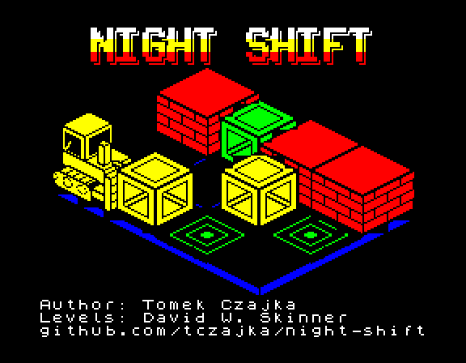
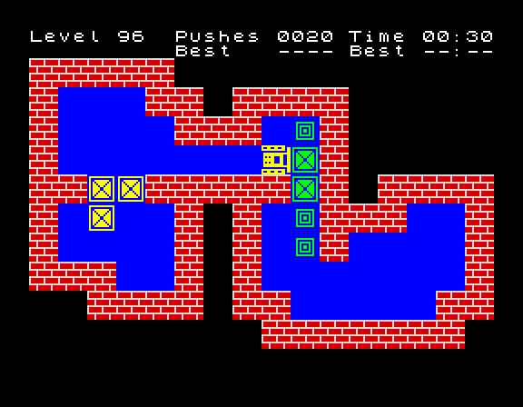

# Night Shift

A Sokoban-style puzzle game for the ZX Spectrum 48K.

Push crates onto their target spots to clear each level. You can push a
crate but never pull it, and you can only push one crate at a time, so a
careless move can leave a level unsolvable.

**[Play it in your browser](https://tczajka.github.io/night-shift/)**

Or download the tape file,
[nightshift.tap](https://tczajka.github.io/night-shift/nightshift.tap)
(13 KB), for an emulator or a real Spectrum, and load it with `LOAD ""`.

<p>
  
  
</p>

## Controls

Keyboard, or a Kempston joystick:

| Key | Action |
| --- | --- |
| Q / A / O / P | Up / down / left / right |
| Space | Fire: choose a level, pause, confirm |

A Kempston interface is used whenever one is connected; the keyboard
keeps working alongside it.

## Building and running

Requires [sjasmplus](https://github.com/z00m128/sjasmplus), GNU Make and
Python 3 (standard library only).

```
make          # builds build/nightshift.tap
make run      # builds it and starts it in ZEsarUX as a 48K Spectrum
make clean    # removes build/
```

Development uses [ZEsarUX](https://github.com/chernandezba/zesarux). To
set it up on Ubuntu 24.04, unpack the `ubuntu24_x86_64` build from
its [releases](https://github.com/chernandezba/zesarux/releases) into
`~/opt/zesarux-13.0` and install its one missing library with
`sudo apt install libsdl1.2debian`. For another location, use
`make run ZESARUX_DIR=/path/to/ZEsarUX-13.0`.

## Credits

The levels are from Microban, a set of Sokoban puzzles by David W. Skinner
([source](http://www.abelmartin.com/rj/sokobanJS/Skinner/David%20W.%20Skinner%20-%20Sokoban.htm)).

## License

The code is [MIT](LICENSE). The levels are David W. Skinner's, under his
terms from the source page:

> My sets are in two groups: Sasquatch and Microban. These sets may be
> freely distributed provided they remain properly credited.
